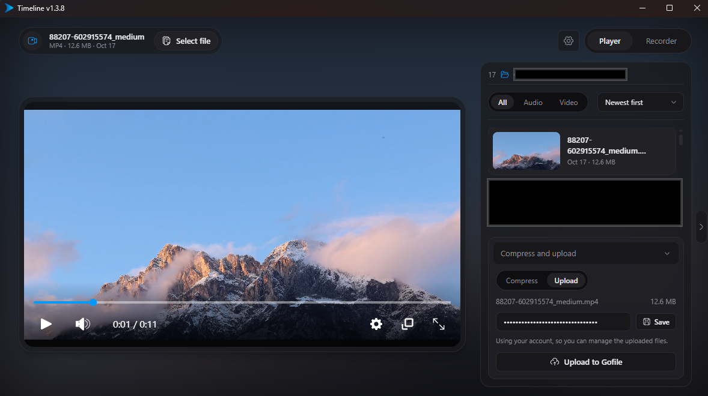

<p align="center">
  
</p>
<h1 align="center">Timeline</h1>
<p align="center">
A fast, simple, and modern media player and screen recorder built for everyday use.
</p>

## 🚀 Features

### 🎬 Player
- ⚡ **Fast** – opens files instantly
- 🎯 **Simple UI** – easy to use, no clutter, in dark or light
- ⌨️ **Custom hotkeys** – control your way
- 🖼️ **Seek previews** – hover the timeline to see a picture of that moment
- ✂️ **Trimming** – frame-accurate cuts, built in
- 🗜️ **Compression** – shrink video files without leaving the app
- ☁️ **Upload** – send media directly from the app
- 📃 **Caption support**
- 🌈 **Ambient mode** – a soft glow of the video's colours behind the player

### 🔴 Recorder
- 🖥️ **Screen recording** – start and stop with a hotkey
- ✨ **Clipping** – always keeps the last few minutes ready, save a clip in one key press
- 🔊 **Sound and mic** – record desktop audio, your microphone, or both
- 👀 **Live preview** – see what is being recorded
- 🎛️ **Your settings** – resolution, frame rate, encoder, bitrate in Kbps (constant or variable), file format
- 🗂️ **Tray mode** – keep recording quietly in the background
- 🛟 **Crash recovery** – unfinished recordings can be recovered

### 🛠️ App
- 🔔 **Popup notifications** – with buttons like *Open clip* and *Show in folder*, even over games
- ⚙️ **One settings window** – General, Player, Recorder, Cache and About
- 🧹 **Cache manager** – see what Timeline stores and clear it
- 🔄 **Auto updates** – always up to date
- 🆓 **Free** – no cost, no paywalls

## 🎞️ Supported Media Types
```js
['.mp4', '.webm', '.mkv', '.avi', '.mov']
['.mp3','.wav','.ogg','.aac','.m4a','.flac','.opus','.weba']
```

## 📸 Preview


## 🖥️ Platform

Currently supported:
- Windows 10
- Windows 11

*(Support for other platforms may come later)*

---

## 🔒 Privacy

Timeline does **not collect personal data**.

The app only collects minimal analytics to improve performance:
- IP address
- Device/software info
- App usage events
- Errors

No personal files or sensitive data are accessed or stored. Recordings and clips stay on your computer.

---

## 📦 Download

Download the latest version from the **Releases** section.

---

## 💡 Why Timeline?

Most media players are slow, outdated, bloated, or just hard to use.
I felt the same, so I built Timeline — and now I’m sharing it with you.

Timeline focuses on:
- speed
- simplicity
- clean experience

---

## 🛠️ Status

Actively being developed and improved.

---

## ❤️ Feedback

If you like it or have suggestions, feel free to email me at sukritthakur821@gmail.com
