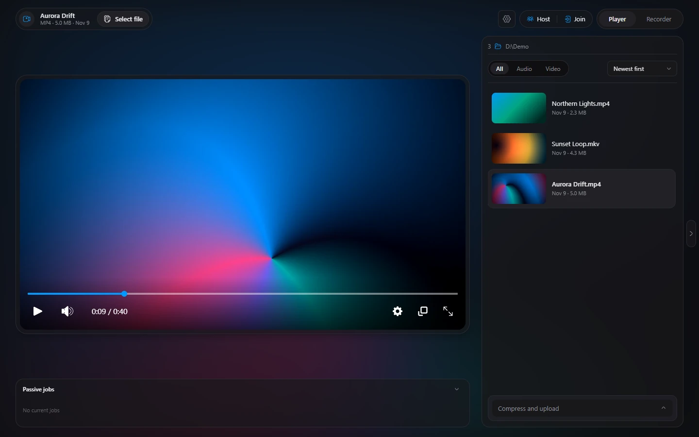
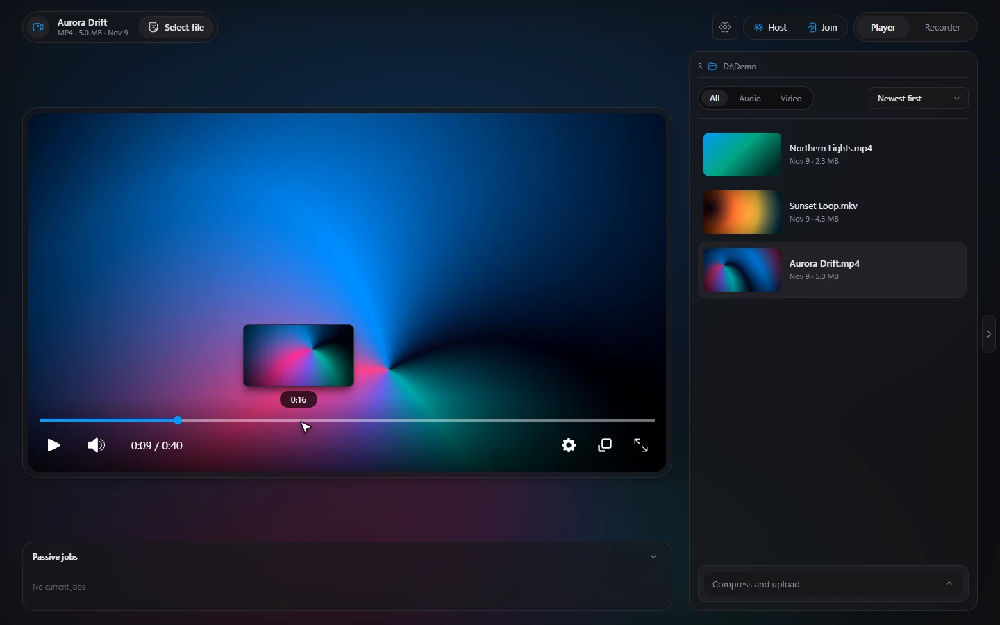
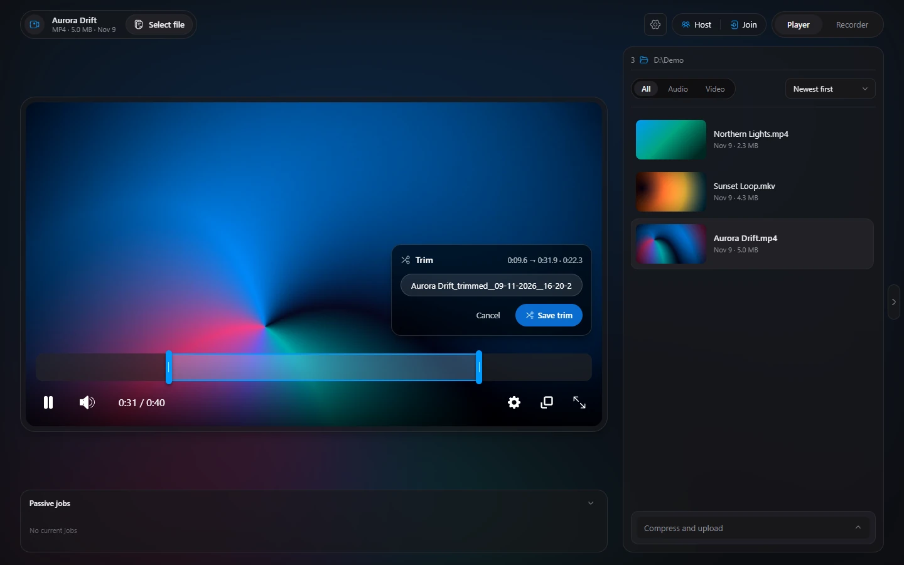
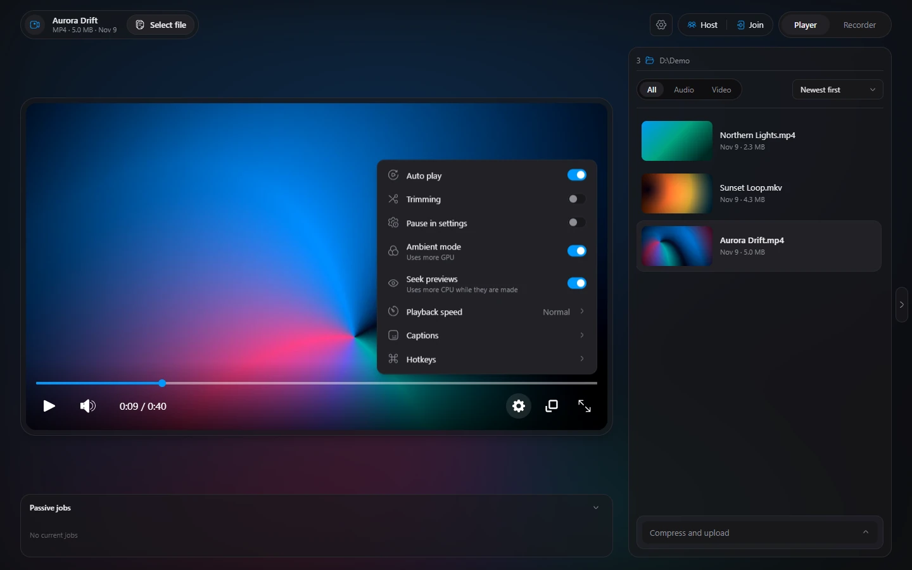
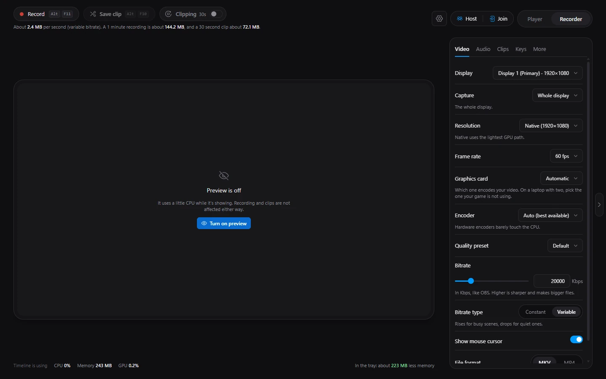
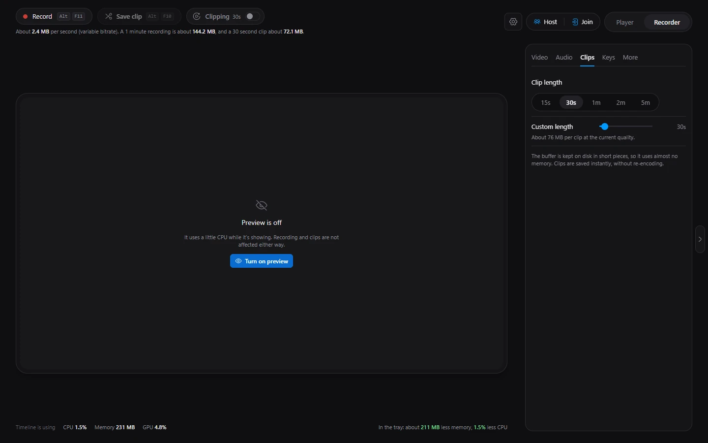
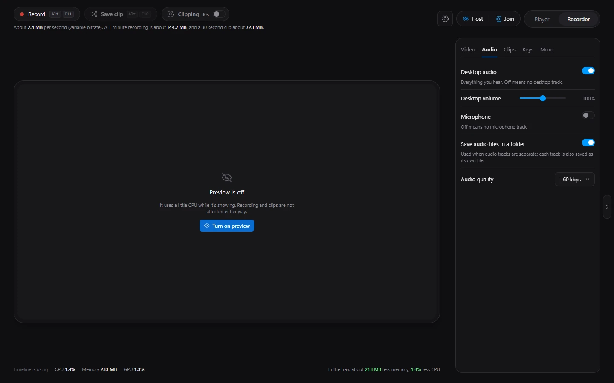
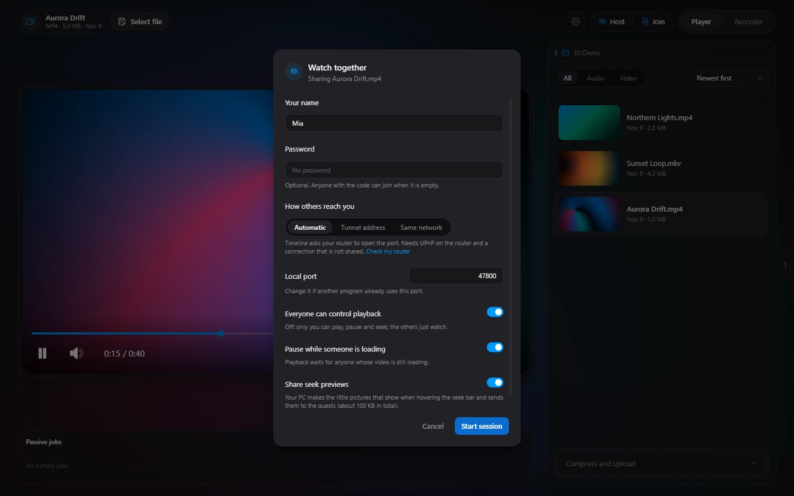
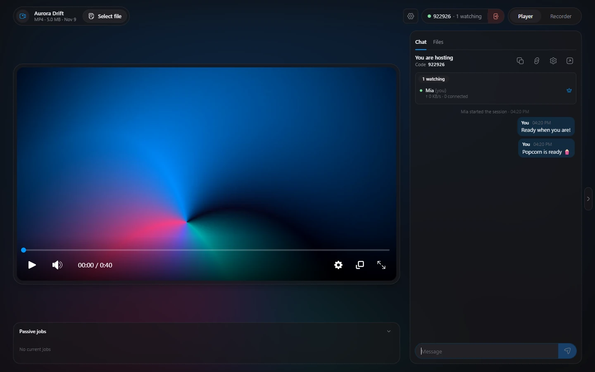
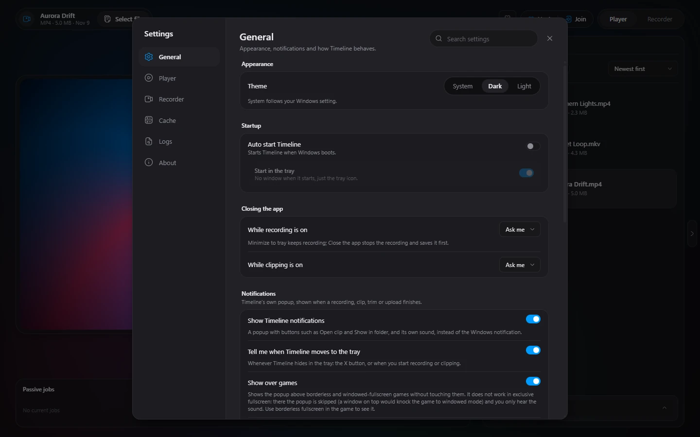

# Timeline

**A fast, free media player and screen recorder for Windows.** 
Seek previews, frame-accurate trimming, one-key clips, and watching together in sync.

&nbsp;

 

<picture>
  <source media="(prefers-color-scheme: light)" srcset="assets/screenshots/player-light.webp" />
  
</picture>

[Player](#-player) · [Recorder](#-recorder) · [Watch together](#-watch-together) · [Shortcuts](#-keyboard-shortcuts) · [Privacy](#-privacy) · [FAQ](#-faq)

---

## ✨ Highlights

|  |  |  |
|---|---|---|
| 🖼️ **Seek previews** Hover the timeline to see that moment before you jump. | ✂️ **Frame-accurate trimming** Cut the start and end, save a new file. No editor needed. | ⚡ **One-key clips** Always keeps the last seconds ready. <kbd>Alt</kbd>+<kbd>F10</kbd> saves them. |
| 🔴 **GPU screen recording** NVENC, AMD AMF, x264, x265 and AV1 where available. | 👥 **Watch together** A 6-digit code, synced playback and chat. No upload. | 🆓 **Free, nothing else to install** ffmpeg is built in. No account, no ads. |

---

## 🎬 Player

<table>
  <tr>
    <td width="50%"> <b>Seek previews:</b> hover the timeline for a picture of that moment.</td>
    <td width="50%"> <b>Trimming:</b> drag the handles, name the file, Save trim.</td>
  </tr>
</table>

- **Plays what you have:** MP4, MKV, WebM, AVI and MOV, plus MP3, WAV, OGG, AAC, M4A, FLAC, Opus and WEBA. Broken files and AVIs are repaired or converted on the fly.
- **Seek previews:** 20 pictures per video, made in the background (they can be switched off).
- **Frame-accurate trimming** with a Save trim panel and a progress bar. The original file is never changed.
- **Playback speed** from 0.1x to 16x, **frame stepping**, jump to 10%…100% with the number keys, picture-in-picture and fullscreen.
- **Captions** (SRT and VTT) with a delay setting.
- **Compress** a video to a target size with your GPU's encoder, and **upload** it to Gofile to get a link.
- **Ambient mode:** a soft glow of the video's colours behind the player.
- **File list** with thumbnails, filters and sorting. Open files from Explorer, or make Timeline your default player.
- **Themes:** Dark, Light, or follow Windows.

<b>See the player settings</b>

 

---

## 🔴 Recorder

<table>
  <tr>
    <td width="50%"> <b>Your settings:</b> display or one window, resolution, fps, encoder, bitrate.</td>
    <td width="50%"> <b>Clipping:</b> choose how far back a clip goes.</td>
  </tr>
</table>

- **Record** a whole display, one window, or any fullscreen window, encoded on the GPU (NVENC, AMD AMF, x264, x265, AV1 where available).
- **Clipping (replay buffer):** turn on **Clipping** and Timeline keeps the last 15 seconds to 5 minutes on disk (or any length from 5 s to 10 min). <kbd>Alt</kbd>+<kbd>F10</kbd> saves a clip instantly, without re-encoding. Recording and clipping can run at the same time.
- **Audio:** desktop sound, your microphone, or both, mixed or on separate tracks. When you capture one window, it can record just that program's sound.
- **Your settings:** resolution, frame rate, bitrate in Kbps (constant or variable), encoder and quality preset, and **MKV** (survives crashes) or **MP4**.
- **Runs from the tray** with the window closed, can start with Windows and start clipping by itself.
- **Safe:** crash recovery for unfinished recordings, a disk-space guard, automatic resume after a lock screen or sleep, and a fallback to x264 if an encoder fails.
- **Pop-up notifications** with buttons (*Open clip*, *Show in folder*) and their own sound, shown over borderless and windowed games.
- **Live preview** of what is being recorded, and Timeline's own CPU, memory and GPU use.

<b>See the audio settings</b>

 

---

## 👥 Watch together

<table>
  <tr>
    <td width="50%"> <b>Host:</b> pick a name, an optional password and how guests connect.</td>
    <td width="50%"> <b>Watch:</b> everyone on the same second, with chat beside the video.</td>
  </tr>
</table>

- **Host** the open video and share a **6-digit code** (optional password) or an invite link `timeline://join/<code>`.
- **In sync:** play, pause, seek and speed follow everyone. The host decides whether everyone can control playback or only the host.
- **Chat and a session log** (who paused, seeked, joined, left), shared captions and seek previews, and per-person network numbers.
- **The host is in charge:** kick, ban and unban, and pause everyone while someone is loading.
- **No upload:** the video streams straight from the host's PC, through automatic UPnP, a tunnel address (playit.gg, ngrok) or the same network. Every viewer needs Timeline.

---

## ⚙️ Settings

One window with **General, Player, Recorder, Cache, Logs** and **About**: theme, start-up and closing behaviour, notifications, the default player, every hotkey, a **cache manager** that shows what Timeline stores and clears it, readable logs for bug reports, and the release notes.

---

## ⚡ Keyboard shortcuts

Every shortcut can be changed in Settings.

| Player | | Recorder (work anywhere) | |
|---|---|---|---|
| <kbd>Space</kbd> | Play / pause | <kbd>Alt</kbd>+<kbd>F11</kbd> | Start recording |
| <kbd>←</kbd> <kbd>→</kbd> | Skip 10 s | <kbd>Alt</kbd>+<kbd>F12</kbd> | Stop recording |
| <kbd>Ctrl</kbd>+<kbd>←</kbd> <kbd>→</kbd> | One frame back / forward | <kbd>Alt</kbd>+<kbd>F10</kbd> | Save a clip |
| <kbd>↑</kbd> <kbd>↓</kbd> | Volume | | |
| <kbd>1</kbd> … <kbd>9</kbd>, <kbd>0</kbd> | Jump to 10% … 100% | | |
| <kbd>M</kbd> · <kbd>F</kbd> · <kbd>Shift</kbd>+<kbd>P</kbd> | Mute · Fullscreen · Picture-in-picture | | |
| <kbd>D</kbd> · <kbd>A</kbd> | Next · Previous file | | |
| <kbd>Ctrl</kbd>+<kbd>S</kbd> | Player settings | | |

---

## 📦 Download

1. Get the installer from the **[latest release](../../releases/latest)** (or the [website](https://timeline.softwaretrinkets.com)).
2. Run it. That's all: ffmpeg and everything else Timeline needs come with it.
3. Timeline updates itself from GitHub releases, and shows what's new after each update.

**Requires** Windows 10 or 11.

---

## 🔒 Privacy

Your files, recordings and clips **stay on your PC**. Watch together streams directly between the people in a session, and the chat never touches a database.

Timeline can share **anonymous usage data** to find bugs and decide what to improve. You can switch it off in **Settings → About → Usage data**.

| Sent | Never sent |
|---|---|
| App version, Windows build, CPU type, rounded RAM | Your name, PC name or IP address |
| Time zone and language | File names, folders or anything you play or record |
| How often features are used (counts only) | Web addresses or e-mail addresses |
| Grouped error messages, with file paths removed | |

---

## 📚 Guides

Step-by-step guides for every feature are on the website:

- [Save the last 30 seconds of gameplay with one key](https://timeline.softwaretrinkets.com/blog/save-the-last-30-seconds-of-gameplay-on-windows)
- [Record your screen with GPU encoding](https://timeline.softwaretrinkets.com/blog/record-your-screen-on-windows-with-gpu-encoding)
- [Watch videos together with friends](https://timeline.softwaretrinkets.com/blog/watch-videos-together-with-friends-on-windows)
- [Trim a video frame-accurately](https://timeline.softwaretrinkets.com/blog/trim-a-video-on-windows-frame-accurately)
- [Every feature, in one page](https://timeline.softwaretrinkets.com/blog/timeline-features-complete-guide)

---

## ❓ FAQ

<b>Is Timeline really free?</b>

 
Yes. No paywalls, no ads, no account.

<b>Does it work on macOS or Linux?</b>

 
Not yet. Timeline is made for Windows 10 and 11.

<b>Where are my recordings and clips saved?</b>

 
By default in a <code>Timeline</code> folder inside your Videos folder. You can change both folders in the Recorder's <b>More</b> tab.

<b>A recorder hotkey does nothing.</b>

 
Another program (often a GPU overlay, which can use <kbd>Alt</kbd>+<kbd>F10</kbd>) owns the key. Timeline shows a warning; pick a new key in the Recorder's <b>Keys</b> tab.

<b>Do my friends need the video for watch together?</b>

 
No. The video streams from the host's PC; guests only need Timeline and the code.

---

## 💡 Why Timeline?

Most media players are slow, outdated, bloated or just hard to use. I felt the same, so I built Timeline, and now I'm sharing it with you. It focuses on speed, simplicity and a clean experience, and it is actively developed.

## 💬 Feedback

Found a bug or have an idea? [Open an issue](../../issues), or e-mail me at **sukritthakur821@gmail.com**.

Made by <a href="https://github.com/LAAGU">LAAGU</a> · Powered by <a href="https://www.softwaretrinkets.com">softwaretrinkets</a>

