

# Timeline

**A fast, free media player and screen recorder for Windows.** 
Seek previews, frame-accurate trimming, one-key clips, and watching together in sync. 
New in 2.0: rebuilt to be tiny (a 5 MB download) and light, using 2-3x less memory.

&nbsp;

 

<picture>
  <source media="(prefers-color-scheme: light)" srcset="assets/screenshots/player-light.webp" />
  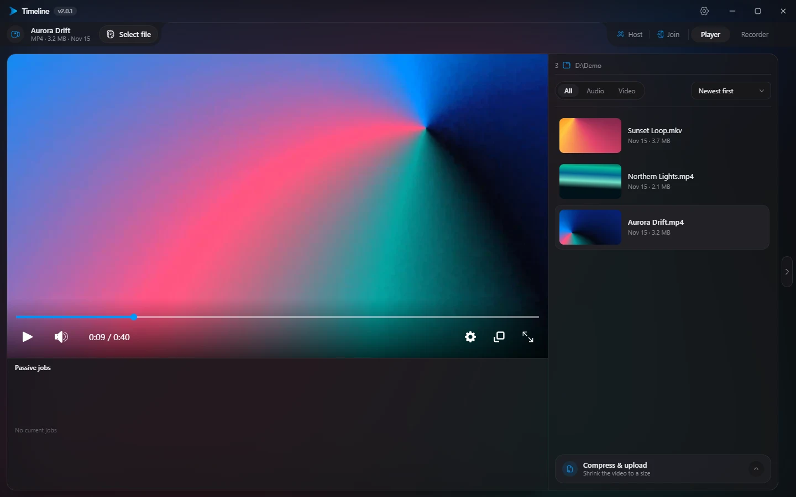
</picture>

[Lighter in 2.0](#-lighter-in-20) · [Player](#-player) · [Recorder](#-recorder) · [Watch together](#-watch-together) · [Shortcuts](#-keyboard-shortcuts) · [Privacy](#-privacy) · [FAQ](#-faq)

---

## ✨ Highlights

|  |  |  |
|---|---|---|
| 🖼️ **Seek previews** Hover the timeline to see that moment before you jump. | ✂️ **Frame-accurate trimming** Cut the start and end, save a new file. No editor needed. | ⚡ **One-key clips** Always keeps the last seconds ready. <kbd>Alt</kbd>+<kbd>F10</kbd> saves them. |
| 🔴 **GPU screen recording** NVIDIA, AMD and Intel encoders: H.264, H.265 and AV1. | 👥 **Watch together** A 6-digit code, synced playback and chat. No upload. | 🪶 **Tiny and light** A 5 MB download. 2-3x less memory than 1.x. |
| 📊 **Best settings for my PC** Recorder settings picked for your graphics card and screen. | 🎮 **Game benchmark** Your game's exact FPS, what Timeline costs it, and why frames drop. | 🆓 **Free** No account, no ads, nothing else to install. |
| 📺 **Streams and free TV** Any video or stream link, or thousands of free channels. | 💬 **Captions online** Find captions for the video you're watching. No account needed. | 🎨 **Caption style** Your colour, size, font, outline and background. |

---

## 🪶 Lighter in 2.0

Timeline 2.0 is rebuilt on a much lighter base (Tauri and Rust instead of Electron and ffmpeg). Everything is still here; it just takes far less from your PC. Updating from 1.x is automatic and keeps your settings.

|  | 1.4.4 (Electron + ffmpeg) | **2.0 (Tauri)** |
|---|---|---|
| Download | about 260 MB | **about 5 MB** |
| Installed size | almost 1 GB | **about 14 MB** |
| Memory, idle | 179 MB | **108 MB** |
| Memory while recording | 499 MB | **162 MB** |
| CPU while recording | 1.1 % | **0.2 %** |
| Trim 60 s of video | **8.8 s** (16.5 % CPU) | 11.2 s (1.4 % CPU) |
| Compress to 50 MB | 11.1 s | 11.4 s |

<picture>
  <source media="(prefers-color-scheme: dark)" srcset="assets/perf/memory-dark.png" />
  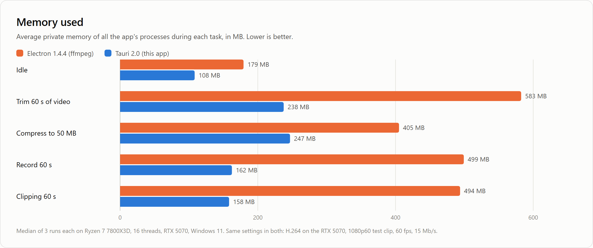
</picture>

<picture>
  <source media="(prefers-color-scheme: dark)" srcset="assets/perf/cpu-dark.png" />
  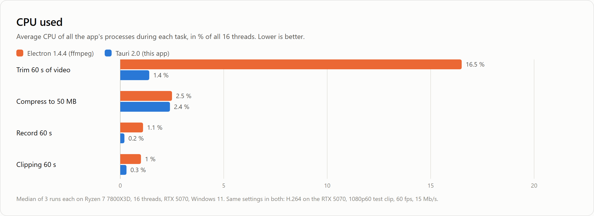
</picture>

<picture>
  <source media="(prefers-color-scheme: dark)" srcset="assets/perf/time-dark.png" />
  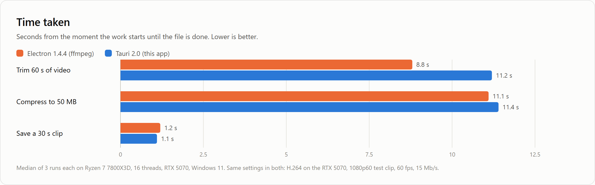
</picture>

<picture>
  <source media="(prefers-color-scheme: dark)" srcset="assets/perf/data-moved-dark.png" />
  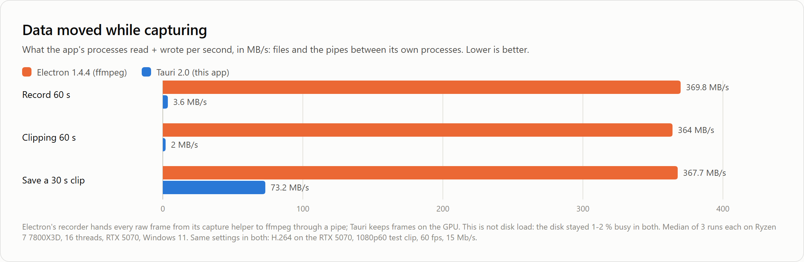
</picture>

<b>More charts: GPU, and memory / CPU over each task</b>

 

<picture>
  <source media="(prefers-color-scheme: dark)" srcset="assets/perf/gpu-dark.png" />
  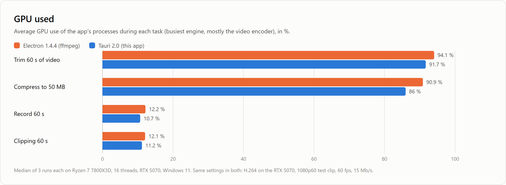
</picture>

<picture>
  <source media="(prefers-color-scheme: dark)" srcset="assets/perf/memory-over-time-dark.png" />
  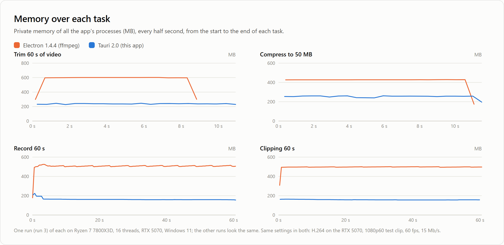
</picture>

<picture>
  <source media="(prefers-color-scheme: dark)" srcset="assets/perf/cpu-over-time-dark.png" />
  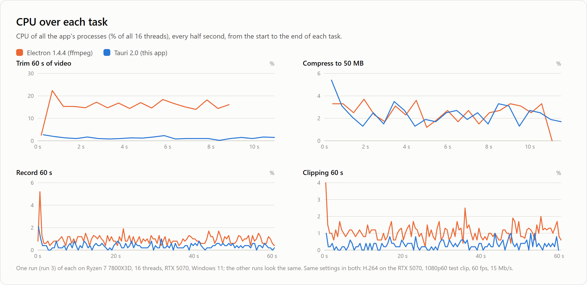
</picture>

<b>How it was measured</b>

 

- **PC:** Ryzen 7 7800X3D (16 threads), RTX 5070, 32 GB, Windows 11. Both versions built for release and run one after the other with fresh settings, 3 runs each (the charts show the middle one; the "over each task" charts show a single run).
- **Same settings in both:** H.264 on the RTX 5070, 60 fps, 15 Mb/s. Test video: 2 minutes, 1920x1080, 60 fps.
- **Tasks:** idle; trim 60 s of the video (frame-exact in both); compress the video to 50 MB ("Medium" preset in both); record a window playing the video for 60 s; clipping for 60 s, then save a 30 s clip.
- **What counts:** every process each version runs (1.4.4: its window and helper processes, recorder service and ffmpeg; 2.0: the app and its window). Memory = private memory, as Task Manager shows it. CPU = share of all 16 threads. GPU = the busiest engine. "Data moved" = what the processes read and write, including the pipes between them: 1.4.4 passes every raw frame from its capture helper to ffmpeg, while 2.0 keeps frames on the graphics card. It is not disk load: the disk stayed 1-2 % busy in both.

---

## 🎬 Player

<table>
  <tr>
    <td width="50%">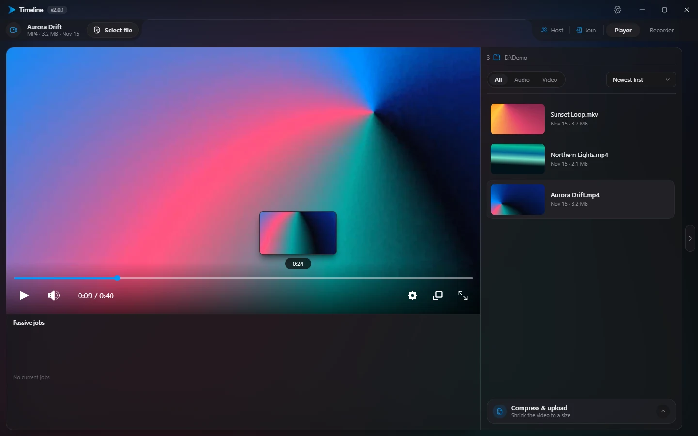 <b>Seek previews:</b> hover the timeline for a picture of that moment.</td>
    <td width="50%">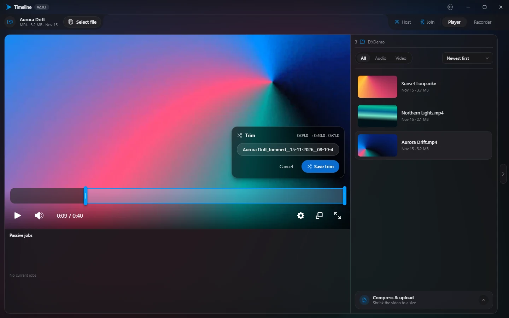 <b>Trimming:</b> drag the handles, name the file, Save trim.</td>
  </tr>
</table>

- **Plays what you have:** MP4, MKV, WebM, AVI and MOV, plus MP3, WAV, OGG, AAC, M4A, FLAC, Opus and WEBA. Broken files and AVIs are repaired or converted on the fly (some very old AVI codecs aren't supported yet; more formats will come with updates).
- **Seek previews:** 20 pictures per video, made in the background (they can be switched off).
- **Frame-accurate trimming** with a Save trim panel and a progress bar. The original file is never changed.
- **Playback speed** from 0.1x to 16x, **frame stepping**, jump to 10%…100% with the number keys, fullscreen, and **picture-in-picture** in a small window that stays on top.
- **Captions** (SRT and VTT) with a delay setting, **found online** for the video you're watching (from OpenSubtitles, in your languages, no account needed), and your own **caption style**: colour, size, font, outline, shadow and background.
- **Streams and free TV:** paste any video or stream link (MP4, HLS `.m3u8` and more), or browse thousands of free channels by country, category or language, each with a green / yellow / red dot showing how fast its server answers. Old broadcast channels (MPEG-2, HEVC, Dolby sound) are converted on your graphics card and play a few seconds behind live without stopping; a **sound sync** setting fixes channels whose sound is off.
- **Compress** a video to a target size with your graphics card's encoder (NVIDIA, AMD, Intel) or Windows' own, and **upload** it to Gofile to get a link.
- **Ambient mode:** a soft glow of the video's colours behind the player.
- **File list** with thumbnails, filters and sorting. Open files from Explorer, or make Timeline your default player.
- **Themes:** Dark, Light, or follow Windows.

<b>See the player settings</b>

 
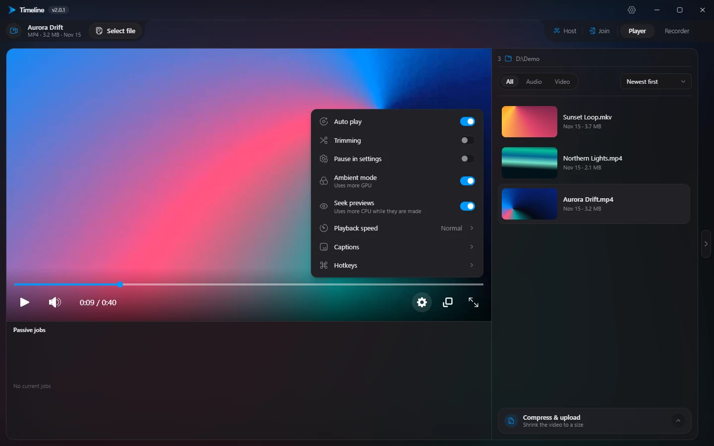

---

## 🔴 Recorder

<table>
  <tr>
    <td width="50%">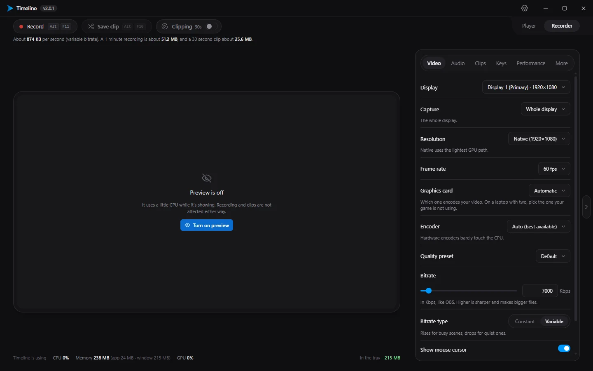 <b>Your settings:</b> display or one window, resolution, fps, encoder, bitrate.</td>
    <td width="50%">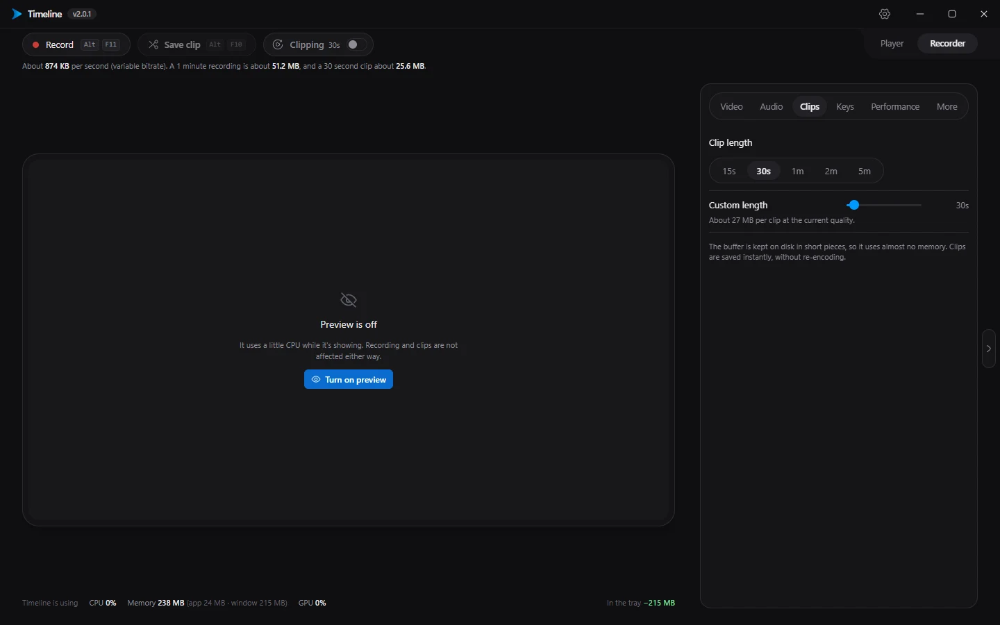 <b>Clipping:</b> choose how far back a clip goes.</td>
  </tr>
</table>

- **Record** a whole display, one window, or any fullscreen window, encoded on your graphics card (NVIDIA, AMD or Intel: H.264, H.265 and AV1 where the card supports them), or with Windows' own H.264 encoder on the CPU. Captured frames stay on the graphics card all the way to the file.
- **Clipping (replay buffer):** turn on **Clipping** and Timeline keeps the last 15 seconds to 5 minutes on disk (or any length from 5 s to 10 min). <kbd>Alt</kbd>+<kbd>F10</kbd> saves a clip instantly, without re-encoding. Recording and clipping can run at the same time.
- **Audio:** desktop sound, your microphone, or both, mixed or on separate tracks. When you capture one window, it can record just that program's sound.
- **Your settings:** resolution, frame rate, bitrate in Kbps (constant or variable), encoder and quality preset, and **MKV** (survives crashes) or **MP4**.
- **Runs from the tray** with the window closed, can start with Windows and start clipping by itself.
- **Safe:** crash recovery for unfinished recordings, a disk-space guard, and automatic resume after a lock screen or sleep.
- **Pop-up notifications** with buttons (*Open clip*, *Show in folder*) and their own sound, shown over borderless and windowed games.
- **Live preview** of what is being recorded, and Timeline's own CPU, memory and GPU use.

<b>See the audio settings</b>

 
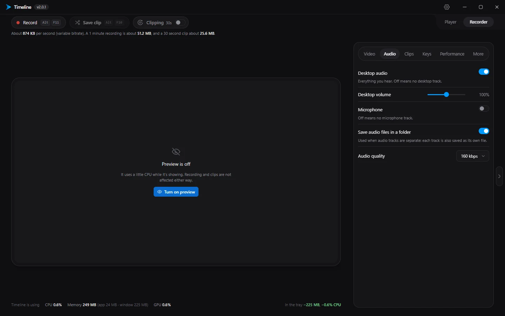

### 📊 Performance tab

<table>
  <tr>
    <td width="50%" align="center">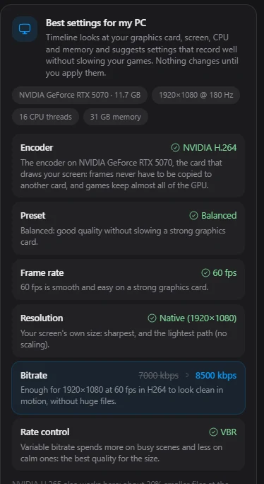 <b>Best settings for my PC:</b> each setting with the reason; nothing changes until you apply it.</td>
    <td width="50%" align="center">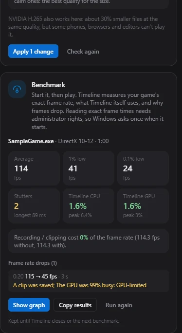 <b>Benchmark:</b> exact FPS, stutters, what Timeline used, and why frames dropped.</td>
  </tr>
</table>

- **Best settings for my PC** looks at your graphics card, screen, CPU and memory, and suggests the encoder, preset, frame rate, resolution and bitrate that record well without slowing your games, each with the reason.
- **Benchmark:** start it (or press <kbd>Ctrl</kbd>+<kbd>Alt</kbd>+<kbd>B</kbd> in game), play, and stop. Timeline reads your game's exact frame times (Windows asks once for administrator rights), measures what Timeline itself used, and explains every drop: Timeline, a busy CPU or GPU, or the game itself. Graphs show **what else was running** on your PC (CPU, graphics card, memory and disk per app) and your PC's limits; click a drop to see exactly what ran at that moment. That part stays on your PC and is never sent. Copy the results as text, open them as a graph, or send them to the developer with a note.

<b>See the benchmark graph</b>

 
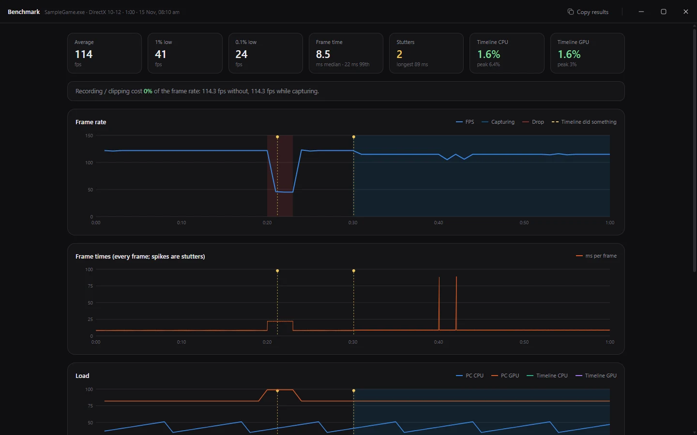

---

## 👥 Watch together

<table>
  <tr>
    <td width="50%">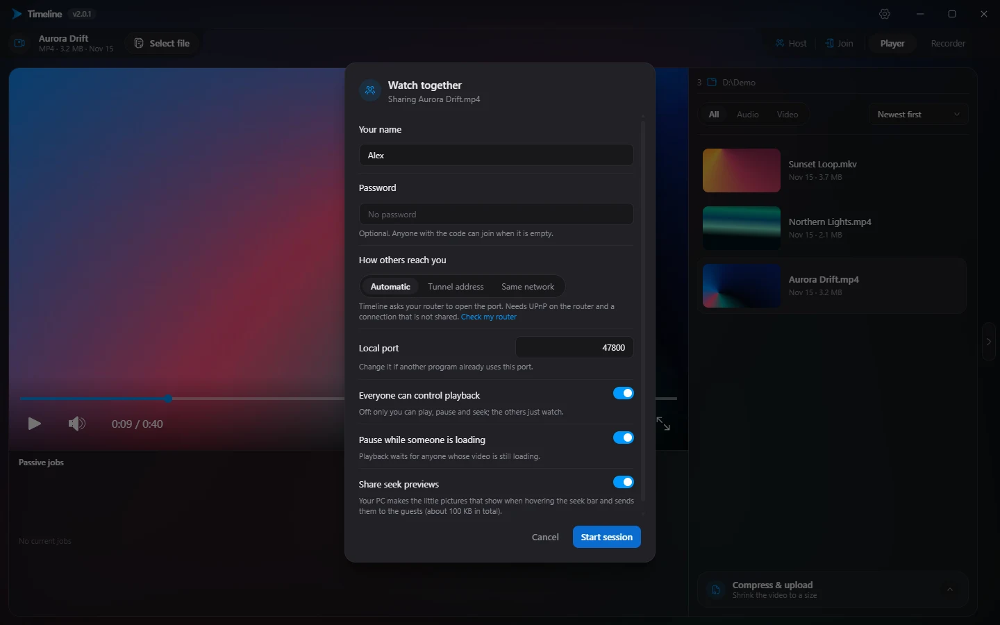 <b>Host:</b> pick a name, an optional password and how guests connect.</td>
    <td width="50%">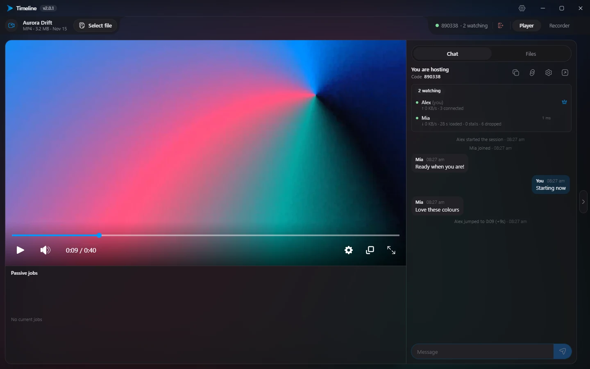 <b>Watch:</b> everyone on the same second, with chat beside the video.</td>
  </tr>
</table>

- **Host** the open video and share a **6-digit code** (optional password) or an invite link `timeline://join/<code>`.
- **In sync:** play, pause, seek and speed follow everyone. The host decides whether everyone can control playback or only the host.
- **Chat and a session log** (who paused, seeked, joined, left), shared captions and seek previews, and per-person network numbers.
- **The host is in charge:** kick, ban and unban, and pause everyone while someone is loading.
- **No upload:** the video streams straight from the host's PC, through automatic UPnP, a tunnel address (playit.gg, ngrok) or the same network. Every viewer needs Timeline.

---

## ⚙️ Settings

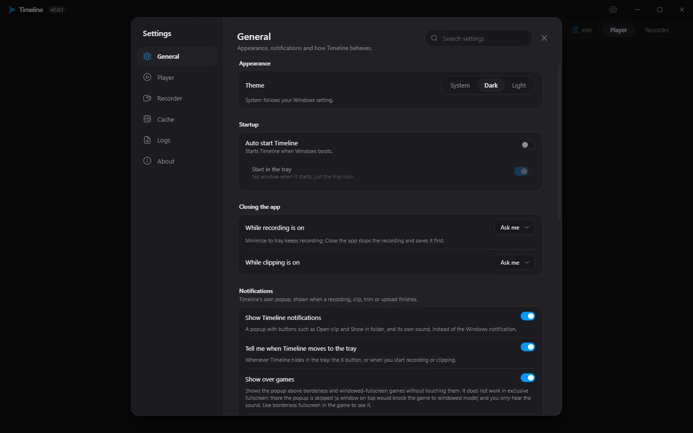

One window with **General, Player, Recorder, Cache, Logs** and **About**: theme, start-up and closing behaviour, notifications, the default player, every hotkey, a **cache manager** that shows what Timeline stores and clears it, readable logs for bug reports (and a button to send a problem report to the developer), and the release notes.

---

## ⚡ Keyboard shortcuts

Every shortcut can be changed in Settings. Recorder shortcuts can also be a **single key** (<kbd>F1</kbd> to <kbd>F24</kbd>, <kbd>Insert</kbd>, <kbd>Home</kbd>, <kbd>Page Up</kbd> …), and the key keeps working in your game or browser too.

| Player | | Recorder (work anywhere) | |
|---|---|---|---|
| <kbd>Space</kbd> | Play / pause | <kbd>Alt</kbd>+<kbd>F11</kbd> | Start recording |
| <kbd>←</kbd> <kbd>→</kbd> | Skip 10 s | <kbd>Alt</kbd>+<kbd>F12</kbd> | Stop recording |
| <kbd>Ctrl</kbd>+<kbd>←</kbd> <kbd>→</kbd> | One frame back / forward | <kbd>Alt</kbd>+<kbd>F10</kbd> | Save a clip |
| <kbd>↑</kbd> <kbd>↓</kbd> | Volume | <kbd>Ctrl</kbd>+<kbd>Alt</kbd>+<kbd>B</kbd> | Start / stop a benchmark |
| <kbd>1</kbd> … <kbd>9</kbd>, <kbd>0</kbd> | Jump to 10% … 100% | | |
| <kbd>M</kbd> · <kbd>F</kbd> · <kbd>Shift</kbd>+<kbd>P</kbd> | Mute · Fullscreen · Picture-in-picture | | |
| <kbd>D</kbd> · <kbd>A</kbd> | Next · Previous file | | |
| <kbd>Ctrl</kbd>+<kbd>S</kbd> | Player settings | | |

---

## 📦 Download

1. Get the installer from the **[latest release](../../releases/latest)** (or the [website](https://timeline.softwaretrinkets.com)).
2. Run it. That's all: everything Timeline needs is in the 5 MB installer.
3. Timeline updates itself from GitHub releases, and shows what's new after each update. On 1.x? It moves to 2.0 by itself and keeps your settings.

**Requires** Windows 10 or 11.

---

## 🔒 Privacy

Your files, recordings and clips **stay on your PC**. Watch together streams directly between the people in a session, and the chat never touches a database.

Timeline can share **anonymous usage data** to find bugs and decide what to improve. You can switch it off in **Settings → About → Usage data**.

| Sent | Never sent |
|---|---|
| App version, Windows build, CPU type, rounded RAM | Your name, PC name or IP address |
| Time zone and language | File names, folders or anything you play or record |
| How often features are used (counts only) | Web addresses or e-mail addresses |
| Grouped error messages, with file paths removed | |

**Captions online:** a search sends only the video's file name and a fingerprint to OpenSubtitles, never the video, and only when you press *Search*. **Streams** play straight from the channel's own server.

**Problem reports and benchmarks** are sent to the developer only when you press *Send* (Settings → Logs, Recorder → Performance), with file names, paths and e-mail addresses removed first.

---

## 📚 Guides

Step-by-step guides for every feature are on the website:

- [Save the last 30 seconds of gameplay with one key](https://timeline.softwaretrinkets.com/blog/save-the-last-30-seconds-of-gameplay-on-windows)
- [Record your screen with GPU encoding](https://timeline.softwaretrinkets.com/blog/record-your-screen-on-windows-with-gpu-encoding)
- [Watch videos together with friends](https://timeline.softwaretrinkets.com/blog/watch-videos-together-with-friends-on-windows)
- [Trim a video frame-accurately](https://timeline.softwaretrinkets.com/blog/trim-a-video-on-windows-frame-accurately)
- [Every feature, in one page](https://timeline.softwaretrinkets.com/blog/timeline-features-complete-guide)

---

## ❓ FAQ

<b>Is Timeline really free?</b>

 
Yes. No paywalls, no ads, no account.

<b>Does it work on macOS or Linux?</b>

 
Not yet. Timeline is made for Windows 10 and 11.

<b>Where are my recordings and clips saved?</b>

 
By default in a <code>Timeline</code> folder inside your Videos folder. You can change both folders in the Recorder's <b>More</b> tab.

<b>A recorder hotkey does nothing.</b>

 
Another program (often a GPU overlay, which can use <kbd>Alt</kbd>+<kbd>F10</kbd>) owns the key. Timeline shows a warning; pick a new key in the Recorder's <b>Keys</b> tab.

<b>Why does the benchmark ask for administrator rights?</b>

 
To read your game's exact frame times, Timeline uses Windows' own frame tracing (the same as PresentMon), which Windows only allows with administrator rights. It asks once when a benchmark starts; nothing else in Timeline ever needs them.

<b>Do my friends need the video for watch together?</b>

 
No. The video streams from the host's PC; guests only need Timeline and the code.

---

## 💡 Why Timeline?

Most media players are slow, outdated, bloated or just hard to use. I felt the same, so I built Timeline, and now I'm sharing it with you. It focuses on speed, simplicity and a clean experience, and it is actively developed.

## 💬 Feedback

Found a bug or have an idea? [Open an issue](../../issues), or e-mail me at **sukritthakur821@gmail.com**.

Made by <a href="https://github.com/LAAGU">LAAGU</a> · Powered by <a href="https://www.softwaretrinkets.com">softwaretrinkets</a>

